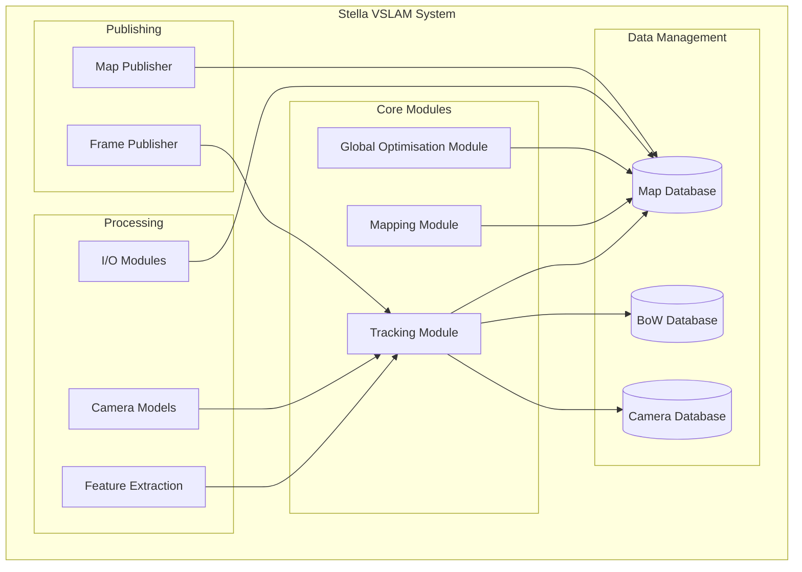
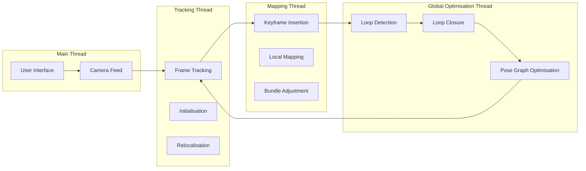
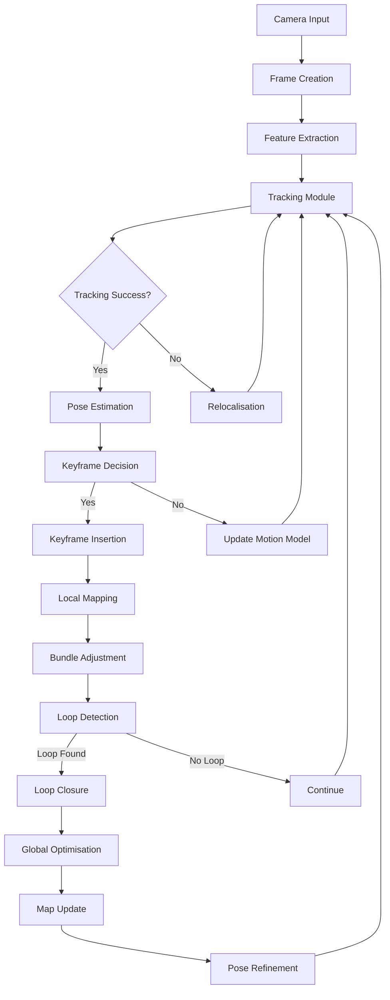
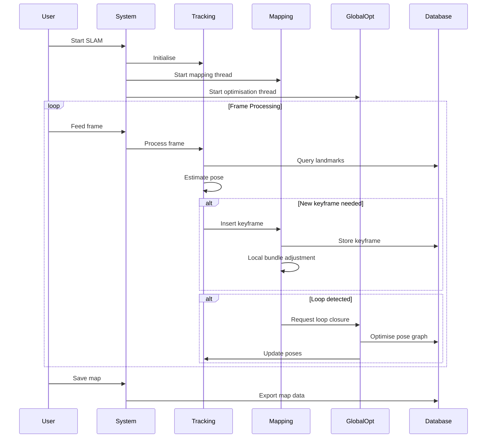
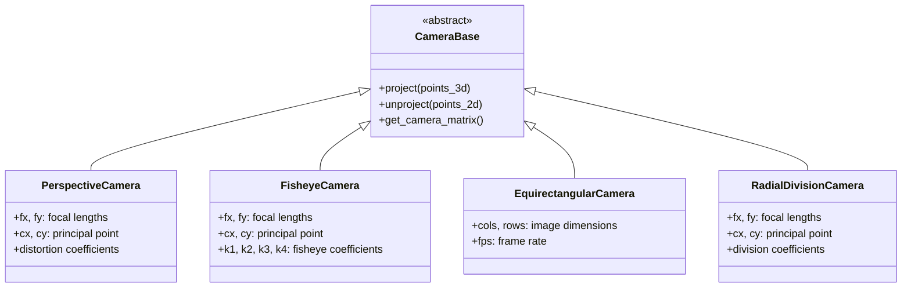
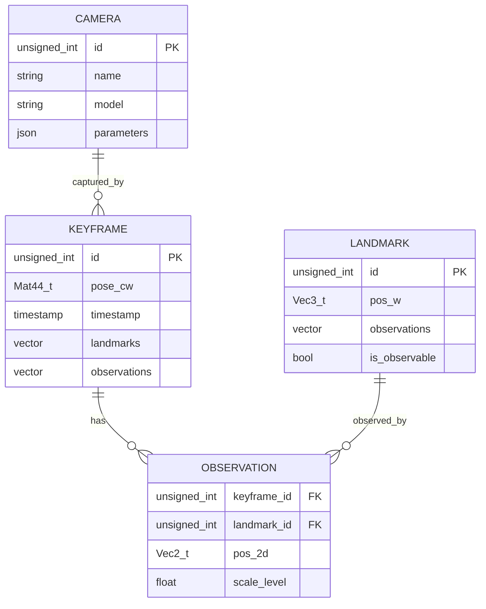
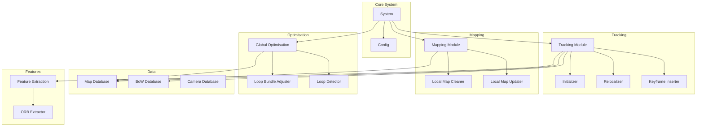
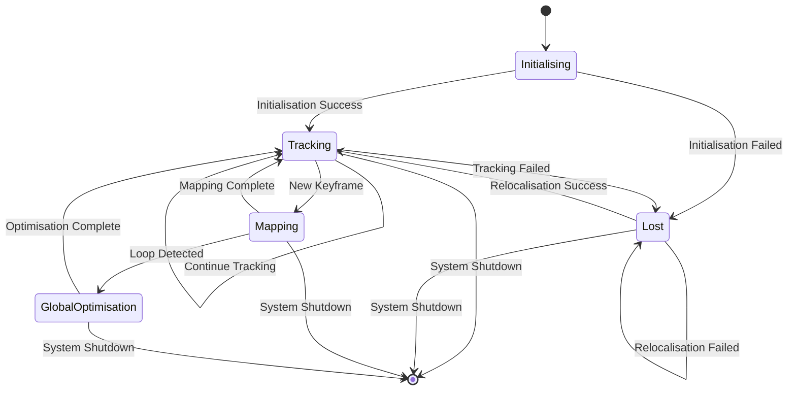

# Stella VSLAM - System Architecture

## High-Level Architecture

## Multi-Threaded Architecture

## Data Flow Architecture

## Component Interaction Diagram

## Camera Model Architecture

## Database Schema

## Module Dependencies

## System State Machine

