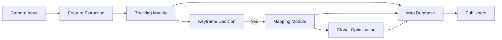
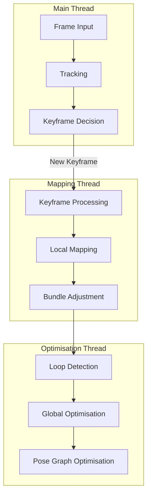
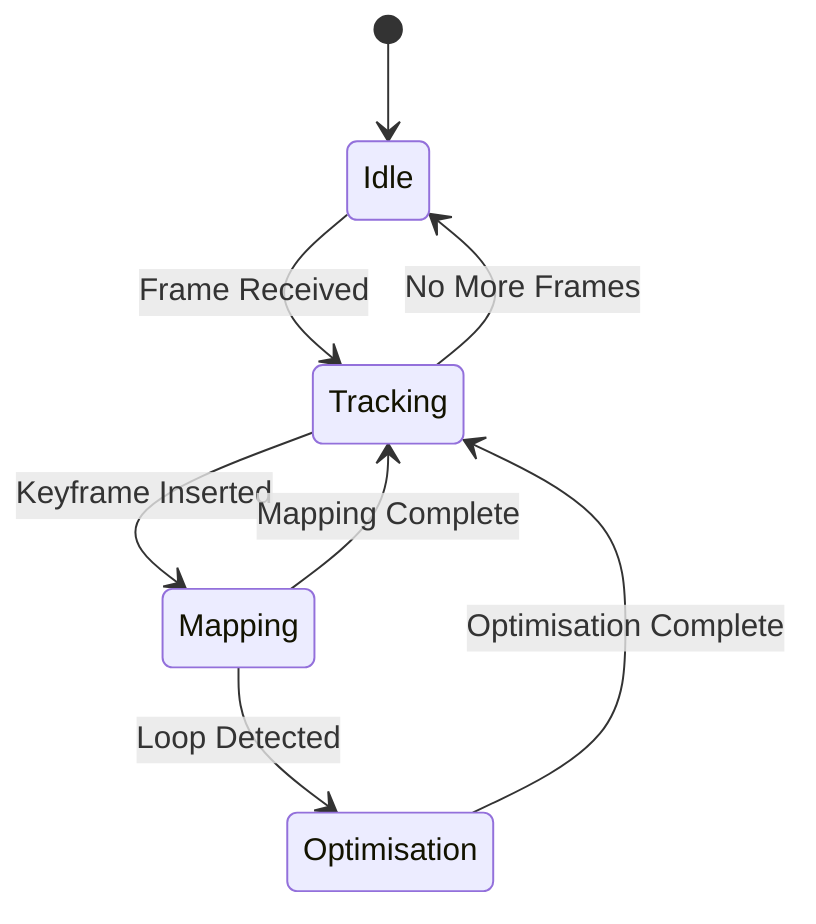

# Stella VSLAM - System Components

## Core System Components

### 1. System Class (`system.h/cc`)

**Purpose**: Main orchestrator and public interface for the SLAM system.

**Key Responsibilities**:
- Initialise and manage all system components
- Provide public API for frame feeding and pose retrieval
- Coordinate between tracking, mapping, and optimisation modules
- Handle system startup, shutdown, and state management

**Key Interfaces**:
```cpp
// System initialisation
system(const std::shared_ptr<config>& cfg, const std::string& vocab_file_path);
void startup(const bool need_initialize = true);
void shutdown();

// Frame feeding methods
std::shared_ptr<Mat44_t> feed_monocular_frame(const cv::Mat& img, const double timestamp);
std::shared_ptr<Mat44_t> feed_stereo_frame(const cv::Mat& left_img, const cv::Mat& right_img, const double timestamp);
std::shared_ptr<Mat44_t> feed_RGBD_frame(const cv::Mat& rgb_img, const cv::Mat& depthmap, const double timestamp);

// Map management
bool save_map_database(const std::string& path) const;
bool load_map_database(const std::string& path) const;

// System control
void pause_tracker();
void resume_tracker();
void request_reset();
void request_terminate();
```

### 2. Tracking Module (`tracking_module.h/cc`)

**Purpose**: Real-time camera pose estimation and frame tracking.

**Key Responsibilities**:
- Track camera pose for each incoming frame
- Handle initialisation and relocalisation
- Manage keyframe insertion decisions
- Maintain motion model for pose prediction

**Key Interfaces**:
```cpp
// Main tracking interface
std::shared_ptr<Mat44_t> feed_frame(data::frame frame);

// Initialisation and relocalisation
bool initialize();
bool relocalize_by_pose(const pose_request& request);

// Keyframe management
bool new_keyframe_is_needed(unsigned int num_tracked_lms, unsigned int num_reliable_lms) const;

// State management
void pause();
void resume();
void reset();
```

**Internal Components**:
- **Initializer**: Two-view geometry initialisation
- **Relocalizer**: Pose recovery from tracking failures
- **Frame Tracker**: Feature-based pose tracking
- **Keyframe Inserter**: Intelligent keyframe selection

### 3. Mapping Module (`mapping_module.h/cc`)

**Purpose**: Background map construction and local optimisation.

**Key Responsibilities**:
- Process new keyframes and create landmarks
- Perform local bundle adjustment
- Manage local map updates
- Handle landmark fusion and removal

**Key Interfaces**:
```cpp
// Keyframe processing
void queue_keyframe(std::shared_ptr<data::keyframe> keyfrm);
void abort_local_BA();

// Map management
void pause();
void resume();
void reset();
```

**Internal Components**:
- **Local Map Updater**: Update local map with new keyframes
- **Local Map Cleaner**: Remove redundant landmarks
- **Bundle Adjuster**: Local optimisation of poses and landmarks

### 4. Global Optimisation Module (`global_optimization_module.h/cc`)

**Purpose**: Loop detection and global map optimisation.

**Key Responsibilities**:
- Detect loop closures using place recognition
- Perform global bundle adjustment
- Optimise pose graph for consistency
- Handle loop closure verification

**Key Interfaces**:
```cpp
// Loop detection and closure
void queue_keyframe(std::shared_ptr<data::keyframe> keyfrm);
bool loop_BA_is_running() const;
void abort_loop_BA();

// System control
void pause();
void resume();
void reset();
```

**Internal Components**:
- **Loop Detector**: Place recognition and loop candidate detection
- **Loop Bundle Adjuster**: Global optimisation after loop closure
- **Pose Graph Optimiser**: Graph-based trajectory optimisation

## Data Management Components

### 5. Map Database (`map_database.h/cc`)

**Purpose**: Central storage for all map data including keyframes, landmarks, and observations.

**Key Responsibilities**:
- Store and retrieve keyframes and landmarks
- Manage spatial indexing for efficient queries
- Handle map serialisation and deserialisation
- Maintain data consistency and integrity

**Key Interfaces**:
```cpp
// Keyframe management
void add_keyframe(std::shared_ptr<data::keyframe> keyfrm);
void erase_keyframe(std::shared_ptr<data::keyframe> keyfrm);
std::vector<std::shared_ptr<data::keyframe>> get_all_keyframes() const;

// Landmark management
void add_landmark(std::shared_ptr<data::landmark> lm);
void erase_landmark(std::shared_ptr<data::landmark> lm);
std::vector<std::shared_ptr<data::landmark>> get_all_landmarks() const;

// Spatial queries
std::vector<std::shared_ptr<data::landmark>> get_close_landmarks(const Vec3_t& pos, const float distance_threshold) const;
```

### 6. BoW Database (`bow_database.h/cc`)

**Purpose**: Bag-of-Words database for efficient feature matching and place recognition.

**Key Responsibilities**:
- Store feature descriptors using vocabulary tree
- Enable fast feature matching for tracking
- Support place recognition for loop detection
- Manage feature-to-keyframe associations

**Key Interfaces**:
```cpp
// Feature insertion and retrieval
void add_keyframe(std::shared_ptr<data::keyframe> keyfrm);
void erase_keyframe(std::shared_ptr<data::keyframe> keyfrm);

// Feature matching
std::vector<std::shared_ptr<data::keyframe>> detect_loop_candidates(std::shared_ptr<data::keyframe> keyfrm) const;
```

### 7. Camera Database (`camera_database.h/cc`)

**Purpose**: Management of camera models and calibration parameters.

**Key Responsibilities**:
- Store camera calibration parameters
- Provide camera model instances
- Handle multiple camera configurations
- Support camera model serialisation

## Feature Processing Components

### 8. Feature Extraction (`feature/`)

**Purpose**: ORB feature detection and description.

**Key Components**:
- **ORB Extractor**: Multi-scale ORB feature extraction
- **ORB Parameters**: Configurable feature extraction parameters
- **ORB Implementation**: Core ORB algorithm implementation

**Key Interfaces**:
```cpp
// Feature extraction
void extract(const cv::Mat& img, const cv::Mat& mask, std::vector<cv::KeyPoint>& keypts, cv::Mat& desc);

// Parameter configuration
void set_scale_factor(const float scale_factor);
void set_num_levels(const unsigned int num_levels);
void set_ini_fast_threshold(const int ini_fast_threshold);
void set_min_fast_threshold(const int min_fast_threshold);
```

### 9. Camera Models (`camera/`)

**Purpose**: Abstract camera model interface with specific implementations.

**Supported Models**:
- **Perspective Camera**: Standard pinhole camera model
- **Fisheye Camera**: Wide-angle fisheye lens model
- **Equirectangular Camera**: 360° panoramic camera model
- **Radial Division Camera**: Custom radial distortion model

**Key Interfaces**:
```cpp
// Projection and back-projection
std::vector<Vec2_t> project(const std::vector<Vec3_t>& pts_3d) const;
std::vector<Vec3_t> unproject(const std::vector<Vec2_t>& pts_2d) const;

// Camera matrix access
cv::Mat get_camera_matrix() const;
cv::Mat get_distortion_coefficients() const;
```

## Publishing and I/O Components

### 10. Map Publisher (`publish/map_publisher.h/cc`)

**Purpose**: Publish map data for visualisation and external consumption.

**Key Responsibilities**:
- Provide current map state for visualisation
- Publish keyframe poses and landmarks
- Support real-time map updates
- Handle map data formatting

### 11. Frame Publisher (`publish/frame_publisher.h/cc`)

**Purpose**: Publish frame data and tracking results.

**Key Responsibilities**:
- Publish current frame with tracking overlay
- Display feature matches and pose information
- Support real-time visualisation
- Handle frame data formatting

### 12. I/O Modules (`io/`)

**Purpose**: Map database serialisation and deserialisation.

**Supported Formats**:
- **MessagePack**: Binary format for efficient storage
- **JSON**: Human-readable format for debugging
- **SQLite**: Database format for complex queries

## Configuration and Utilities

### 13. Configuration (`config.h/cc`)

**Purpose**: System-wide configuration management.

**Key Responsibilities**:
- Load configuration from YAML files
- Validate configuration parameters
- Provide access to system settings
- Support runtime parameter updates

**Configuration Categories**:
- **Camera**: Camera model and calibration parameters
- **Feature**: ORB feature extraction parameters
- **Tracking**: Tracking algorithm parameters
- **Mapping**: Mapping and optimisation parameters
- **System**: General system parameters

### 14. Utilities (`util/`)

**Purpose**: Common utility functions and data structures.

**Key Components**:
- **Math Utilities**: Geometric and mathematical functions
- **Image Processing**: Image manipulation utilities
- **File I/O**: File handling utilities
- **Timing**: Performance measurement utilities

## Component Interaction Patterns

### Data Flow Pattern



### Threading Pattern



### State Management Pattern

